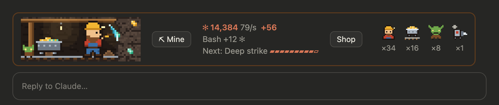
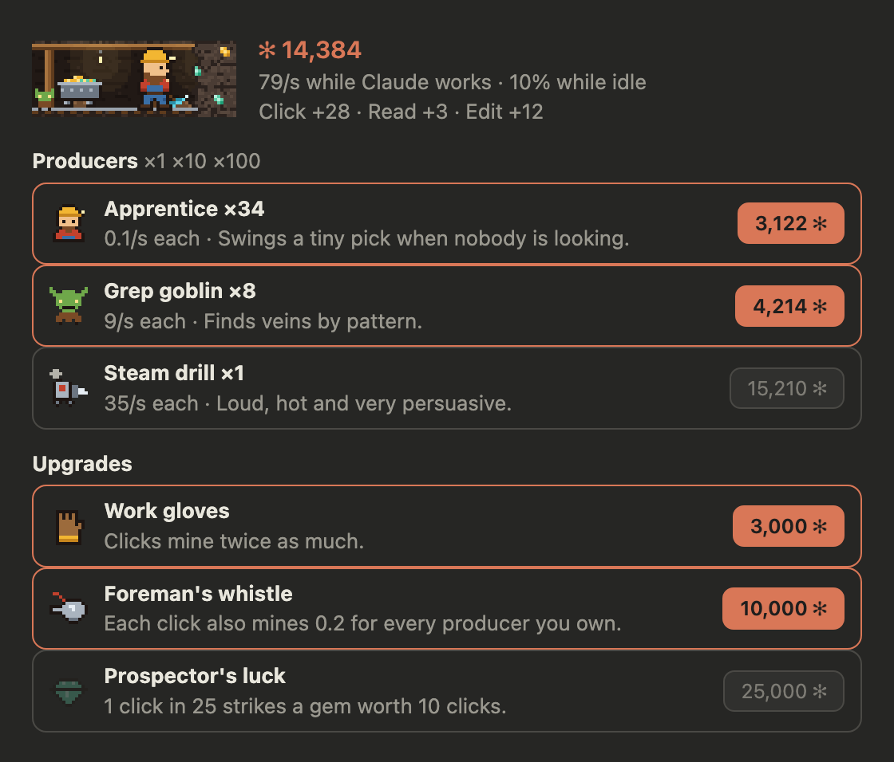

# sparkmine

An idle clicker game for Claude Code, built as a
[Claude Code mod](https://code.claude.com/docs/en/plugins/mods/overview).
Claude works. You click.



While Claude works, a pixel miner digs in the band above your prompt. Every
tool call Claude makes mines sparks ✻, and each press of **Mine** mines more.
Spend them in the shop on a crew that keeps digging, and on upgrades.



## Install

Needs Claude Code v2.1.287 or later. In Claude Code, run:

```
/plugin install sparkmine --marketplace tozmoz/sparkmine
```

Pick the user scope to have it in every session, including the Code tab of
the Claude Desktop app.

## Play

- Press **Mine** while Claude works. Clicks count only then.
- Open the shop with **Shop** or `/mine`. Producers mine every second Claude
  works; upgrades make clicks, tool calls and the crew stronger.
- **Collapse the mine** in the shop to trade a run for ◆ crystals, which add
  2% to everything for good.

All your sessions share one save, so they mine into the same mine.

| Command | What it does |
| :- | :- |
| `/mine` | Opens the shop |
| `/mine hide`, `/mine show` | Hides the band, and brings it back |
| `/mine reset` | Deletes your save, after asking |

To stop it entirely, disable or uninstall it from `/plugin`. Your save stays
until you reset it.

## What it touches

It counts tool calls, turns and permission prompts, and changes none of them.
It never calls a model, the network or a process, so it costs no tokens. It
keeps one small save on your machine.

## License

MIT
