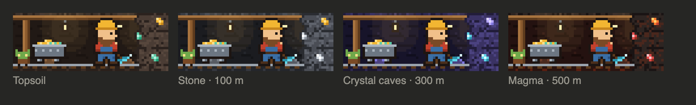

# sparkmine

An idle clicker game for Claude Code, built as a
[Claude Code mod](https://code.claude.com/docs/en/plugins/mods/overview).
Claude works. You click.


While Claude works, a pixel miner digs in the band above your prompt. Every
tool call Claude makes mines sparks ✻, and each press of **Mine** mines more.
Claude's own work pays too: a test run that passes, a commit, a long turn.
Spend it all in the shop on a crew that keeps digging, and on upgrades.


## Install

Needs Claude Code v2.1.287 or later. In a terminal, run:

```bash
claude plugin marketplace add tozmoz/sparkmine
claude plugin install sparkmine@sparkmine --scope user
```

The user scope puts it in every session, including the Code tab of the Claude
Desktop app. New sessions load it; in open ones, run `/reload-plugins`. Inside Claude Code, `/plugin install sparkmine --marketplace
tozmoz/sparkmine` does the same.

To update later:

```bash
claude plugin marketplace update sparkmine
claude plugin update sparkmine@sparkmine
```

## Play

- Press **Mine** while Claude works. Clicks count only then.
- Open the shop with **Shop** or `/mine`. Producers mine every second Claude
  works; upgrades make clicks, tool calls and the crew stronger. The shop's
  stats show where your sparks came from.
- **Claude's work pays**, once a turn each: tests that pass, a commit, and a
  turn longer than five minutes.
- **Veins:** now and then a gold vein shows beside the Shop sign for ten
  seconds. Catch it for two minutes of income, or a ×5 frenzy for thirty.
- **Depth:** the mine goes a hundred metres deeper with every tenfold of
  sparks, through topsoil, stone, crystal caves and magma.

  

- **Collapse the mine** in the shop to trade a run for ◆ crystals, which add
  2% to everything for good. The mine starts again at the surface.

All your sessions share one save, so they mine into the same mine.

| Command | What it does |
| :- | :- |
| `/mine` | Opens the shop |
| `/mine stop`, `/mine start` | Stops the game in every session, and starts it again |
| `/mine compact` | Keeps the band to one line, even while Claude works |
| `/mine hide`, `/mine show` | Hides the band in this session, and brings it back |
| `/mine reset` | Deletes your save, after asking |

To remove it, disable or uninstall it from `/plugin`. Your save stays until
you reset it.

## What it touches

It counts tool calls, turns and permission prompts, and reads whether a test
run passed or a commit landed. It changes none of them. It never calls a
model, the network or a process, so it costs no tokens. It keeps one small
save on your machine.

## License

MIT
