# sparkmine

A pixel-art mining clicker that lives above your Claude Code prompt.
Claude works. You click.



While Claude works, a miner digs an endless tunnel in the band above your
prompt. Each swing takes him deeper: fresh rock comes in from the right, and
the timbers, lanterns and spoil heaps he leaves behind slide away. Every tool
call Claude makes is ore. Press **Mine** to dig faster: each press throws a
few sparks off the counter. Spend your sparks in the shop, and your crew lines
up on the right of the band. When the turn ends, the band shrinks to one line.

## Install

Sparkmine is a [Claude Code mod](https://code.claude.com/docs/en/plugins/mods/overview).
It needs Claude Code v2.1.287 or later. In a terminal session, run:

```
/plugin install sparkmine --marketplace tozmoz/sparkmine
```

Answer `y` to add the marketplace, then pick a scope. Installed at the user
scope, it also runs in the Code tab of the Claude Desktop app.

## Play

- **Sparks ✻** are the currency. You mine them by pressing Mine while Claude
  works, and Claude mines them with every tool call it makes.
- **Producers** mine every second Claude works. There are eight, from the
  Apprentice to the Context core, and each one costs 17% more than the last.
- **Upgrades** unlock at milestones: clicks, tool calls of a kind, producers
  owned, turns finished. There are 53 of them. The pick upgrades change the
  pick in the miner's hands, from worn iron to steel, diamond and obsidian.
- **Collapse the mine** to trade a run for ◆ crystals. Each crystal adds 2% to
  everything, for good.
- **Spinner words** unlock as your all-time sparks grow: Mining, Tunneling,
  Prospecting, Smelting and Excavating.

The miner waits with you: while a permission prompt or a question waits on
your answer, the band says so and the Mine button steps aside.

It is a slow game on purpose. A busy day of work buys a handful of producers,
and the last of them takes weeks.

| Command | What it does |
| :- | :- |
| `/mine` | Opens the shop |
| `/mine hide`, `/mine show` | Hides the band, and brings it back |
| `/mine reset` | Deletes your save, after asking |

`Ctrl+X Ctrl+A` collapses the band, as it does for every mod.

## Where it draws

- **Desktop app:** the scene is an SVG that animates itself with CSS. The
  counter is a Client of a fixed size, so a press updates the numbers without
  redrawing the scene.
- **Terminal:** the same pixels become a Raster of half-block cells, repainted
  by a timer. The scene needs about 94 columns; a narrower terminal gets the
  text and buttons alone.

## What it touches

A mod runs inside Claude Code with your permissions, so here is all of it:

- It watches tool calls, permission checks, turns and sessions, and changes
  none of them. It only counts them.
- It draws the band above the prompt, a shop pane, and the spinner's word.
- It never calls a model, the network or a process.
- It keeps one save in its own store, which every session on the machine
  shares, so two sessions mine into one mine.

`claude plugin validate` prints the same list from the source.

## Develop

```bash
claude --plugin-dir ./sparkmine
claude plugin validate ./sparkmine
claude plugin test ./sparkmine
```

The economy is plain functions in `hooks/game.ts`, priced in `hooks/data.ts`.
The pixel art is `hooks/scene.ts`, and the hooks are `hooks/register.tsx`.

## License

MIT
